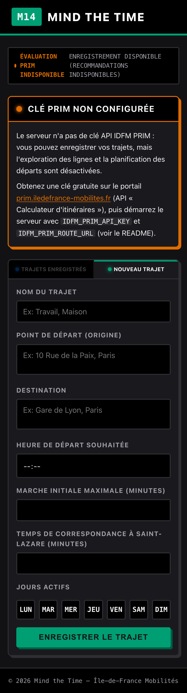
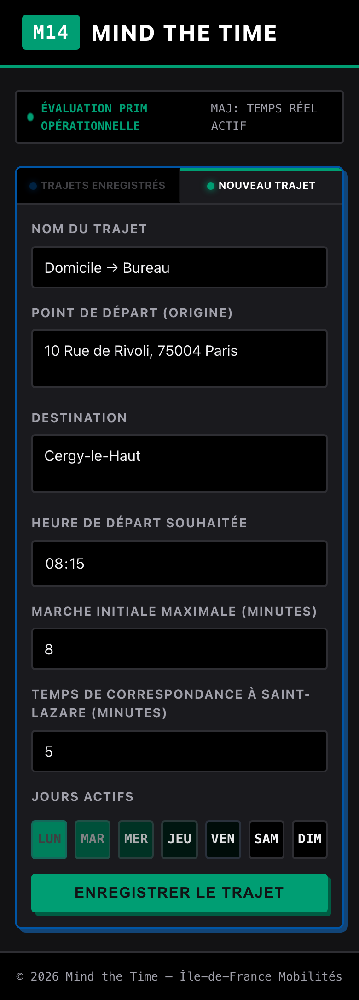
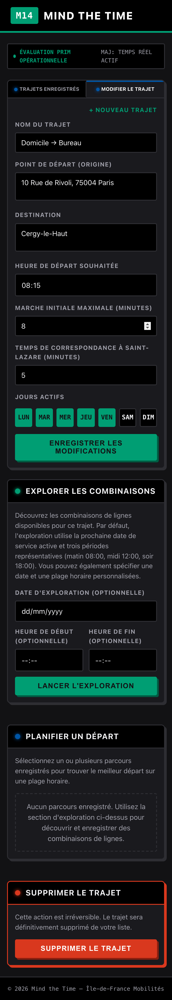

# Mind the Time

Mind the Time est une application Go pour enregistrer un trajet domicile-travail récurrent en Île-de-France, explorer des combinaisons de lignes et planifier les départs de celles qui ont été sauvegardées. Les propriétaires et leurs trajets sont conservés côté serveur dans un fichier d’état local, avec une durée de vie et une capacité limitées.

## Aperçu

L’interface est une PWA pensée pour le mobile (thème « transit », installable sur l’écran d’accueil).

| Sans clé PRIM | Nouveau trajet | Trajet enregistré |
| --- | --- | --- |
|  |  |  |

## Fonctionnement actuel

Le parcours utilisateur comporte trois étapes :

1. **Explorer** des candidats de parcours sur une date de service et des instants représentatifs. Sans plage personnalisée, l’application utilise la prochaine date de service active, à `08:00`, `12:00` et `18:00`. Avec une plage, elle vérifie le début, le milieu et la fin de cette plage.
2. **Enregistrer** les combinaisons vérifiées. Une combinaison sauvegardée a un identifiant opaque et conserve l’identité fournisseur de chaque trajet en transport, ligne, arrêt de montée et arrêt de descente. Les libellés affichés ne servent pas à l’identifier. La date d’exploration et sa plage ne sont pas sauvegardées avec elle.
3. **Planifier** une ou toutes les combinaisons sauvegardées sélectionnées, sur une date et une plage d’exécution. La planification ne relance pas la découverte. Elle demande les horaires de chaque motif exact, puis ne compose que des correspondances réellement renvoyées dans cet instantané.

La configuration PRIM est disponible quand `IDFM_PRIM_API_KEY` est renseignée et que `IDFM_PRIM_ROUTE_URL` est une URL HTTPS valide. Un `503 Service Unavailable` reste possible si le fournisseur est indisponible ou si son contrat reçu n’est pas pris en charge, mais une configuration valide n’est plus catégoriquement désactivée. Aucun itinéraire, départ ou conseil théorique n’est fabriqué lorsqu’aucun résultat exploitable n’est renvoyé.

## Sélection et classement

Seuls les candidats effectivement renvoyés par le fournisseur sont examinés. L’exploration conserve ceux qui comportent au moins un segment de transport et correspondent aux lignes préférées du trajet, si elles sont renseignées.

Les candidats admissibles sont classés, dans cet ordre :

1. durée porte-à-porte la plus courte ;
2. moins de correspondances ;
3. somme des intervalles entre segments de transport la plus faible ;
4. marge minimale par rapport au temps de correspondance configuré la plus grande.

Les temps personnels de marche d’accès et de correspondance sont appliqués pendant la planification. Ils déplacent l’heure de départ et déterminent les enchaînements horaires viables, sans écarter un candidat fournisseur lors de l’exploration.

## Démarrage local

Pré-requis : Go 1.26 et `golangci-lint`.

```sh
go mod download
HTTP_ADDR=127.0.0.1:5435 COOKIE_SECURE=false STORE_PATH=data/mind-the-time.json go run ./cmd/mind-the-time
```

Ouvrir ensuite `http://127.0.0.1:5435`. Le port 5435 est dédié au serveur de développement de ce projet pour éviter les collisions avec les ports 5100-5103, largement utilisés par d’autres outils locaux.

`STORE_PATH` désigne le fichier d’état persistant et vaut par défaut `data/mind-the-time.json`. Il doit pointer vers un emplacement local inscriptible et persistant entre les redémarrages. Le répertoire `data/` est volontairement ignoré par Git.

### Vérification qualité

```sh
go test ./...
go test -race ./...
go vet ./...
golangci-lint run
go build ./cmd/mind-the-time
go clean
```

`staticcheck` doit être exécuté avec une version compilée pour Go 1.26 ou ultérieur.

## Configuration et limite PRIM

Les seules variables PRIM sont :

```sh
IDFM_PRIM_API_KEY='…'
IDFM_PRIM_ROUTE_URL='https://…'
```

Elles permettent les requêtes PRIM côté serveur. `PRIMConfigured` est vrai seulement avec une clé non vide et une URL HTTPS valide. Ne pas déduire ni documenter un schéma PRIM qui ne figure pas dans le contrat effectivement pris en charge.

### Obtenir une clé PRIM

1. Créer un compte sur le portail PRIM d’Île-de-France Mobilités : <https://prim.iledefrance-mobilites.fr>.
2. Dans le catalogue, souscrire à l’API **Calculateur d’itinéraires** (Navitia, « journeys »).
3. Dans « Mes jetons d’authentification », générer un jeton : c’est la valeur de `IDFM_PRIM_API_KEY`.
4. Renseigner l’URL de l’endpoint « journeys » dans `IDFM_PRIM_ROUTE_URL`, par exemple `https://prim.iledefrance-mobilites.fr/marketplace/v2/navitia/journeys`. L’endpoint `route_schedules` utilisé pour la planification est dérivé de cette URL.
5. Placer ces deux variables dans un fichier `.env` local (ignoré par Git), chargé automatiquement par le Taskfile, ou les exporter dans l’environnement du serveur.

Sans ces variables, l’application démarre quand même : l’écran d’accueil affiche « Évaluation PRIM indisponible », l’enregistrement des trajets fonctionne, mais l’exploration et la planification des départs sont désactivées.

La contrainte opérationnelle PRIM est de **1 000 requêtes par jour**. Planifier l’exploration et les requêtes de planification dans cette enveloppe. Les réglages `ROUTE_RATE_PER_SECOND` et `ROUTE_RATE_BURST` limitent les appels manqués à court terme, ils ne remplacent pas ce suivi quotidien.

Variables optionnelles : `HTTP_ADDR`, `ADDR`, `COOKIE_SECURE`, `COOKIE_NAME`, `STORE_PATH`, `HTTP_TIMEOUT`, `CACHE_TTL`, `CACHE_MAX_ENTRIES`, `ROUTE_RATE_PER_SECOND` et `ROUTE_RATE_BURST`. `ADDR` est un repli de compatibilité pour `HTTP_ADDR` ; `HTTP_ADDR` est prioritaire.

Par défaut le serveur écoute sur `127.0.0.1:8080` (boucle locale uniquement). L’application n’ayant pas d’authentification, n’exposez le service sur le réseau (`HTTP_ADDR=0.0.0.0:…`) que volontairement, idéalement derrière un reverse proxy.

Variables de test : `PRIM_REPLAY_DIR`, `PRIM_REPLAY_STRICT` et `NOW_OVERRIDE`. Elles servent à rendre les appels fournisseur et les dates reproductibles, pas à configurer une instance de production.

Le cookie propriétaire s’appelle par défaut `mind_the_time_owner`. Il est limité au chemin `/`, marqué `HttpOnly`, `SameSite=Lax` et `Secure` par défaut. `COOKIE_SECURE=false` est réservé explicitement au développement local en HTTP. Il relie uniquement ce navigateur à ses données côté serveur : l’application ne propose ni compte, ni connexion, ni système d’authentification.

Les pages dynamiques limitées à un propriétaire envoient `Cache-Control: no-store`.

Le `FileStore` conserve un propriétaire côté serveur pendant 90 jours après sa dernière utilisation et limite ses données à 25 trajets par propriétaire. Ces limites sont appliquées par l’adaptateur de stockage, et ne se configurent pas par variables d’environnement.

Un `STORE_PATH` prend en charge exactement un processus serveur et un seul écrivain. Il ne doit pas être partagé simultanément entre plusieurs processus, conteneurs ou réplicas. Le `FileStore` ne possède aucun verrouillage interprocessus, ses verrous sont locaux au processus.

## Confidentialité du fichier d’état

Le fichier `STORE_PATH` contient les identifiants opaques de propriétaires et les données de trajets (notamment origine et destination). Il doit être traité comme une donnée privée : ne pas le publier, ne pas le servir par HTTP et protéger ses sauvegardes. Lors de sa création, l’application crée son répertoire parent avec le mode `0700` et le nouveau fichier avec le mode `0600`. Pour un instantané `STORE_PATH` existant, l’application répare son mode à `0600` avant le chargement. Le démarrage échoue si cette réparation ne peut pas aboutir.

## Tests E2E reproductibles

Les tests E2E usuels sont exclusivement en mode replay. `task e2e` lance un serveur isolé avec son propre `STORE_PATH`, sur `E2E_PORT` ou le port `5436` par défaut. Il fixe l’horloge à `NOW_OVERRIDE=2026-08-11T12:00`, lit les fixtures de `e2e/fixtures`, active `PRIM_REPLAY_STRICT=true` et fournit une clé API factice.

Une fixture manquante fait échouer le test. Elle ne doit ni être enregistrée ni provoquer un appel de repli vers PRIM. Les tests E2E de routine ne demandent donc aucun secret PRIM et n’effectuent aucun appel réseau au fournisseur.

Les fixtures de `e2e/fixtures/` sont des enregistrements locaux ignorés par Git : elles contiennent les recherches d’itinéraires réellement effectuées (adresses, coordonnées) et ne sont pas publiées. Pour exécuter les suites E2E, enregistrez vos propres fixtures (`PRIM_REPLAY_DIR` sans mode strict, avec de vrais identifiants PRIM), puis renseignez `MTT_E2E_ORIGIN` et `MTT_E2E_DESTINATION` — par exemple dans `.env`, chargé automatiquement par le Taskfile — avec le couple origine/destination utilisé lors de l’enregistrement.

## Secrets

Ne jamais committer de clé PRIM, de jeton de session, de clé VAPID ou de fichier `.env`. En développement, charger les secrets depuis un fichier `.env` local ignoré par Git ou un gestionnaire de secrets approuvé. Le navigateur ne doit jamais appeler PRIM directement.
